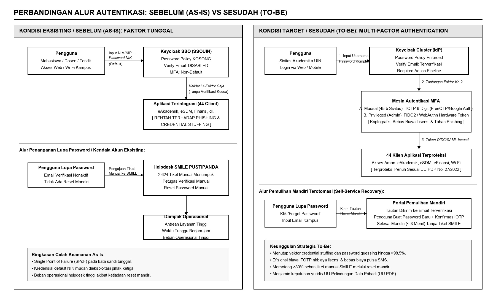
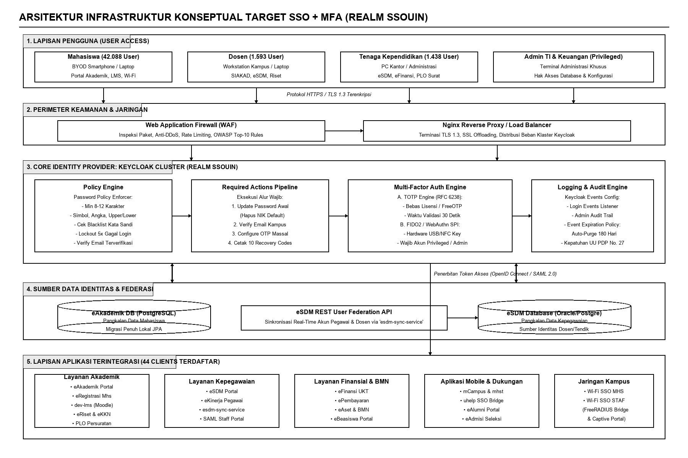
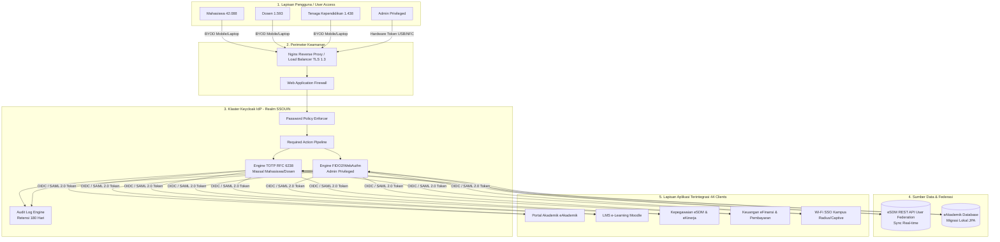

# Perencanaan Strategis Pengembangan Single Sign-On (SSO) Terintegrasi Multi-Factor Authentication (MFA) Menggunakan Metode Ward & Peppard pada UIN Syarif Hidayatullah Jakarta

**Applied Information System and Management (AISM)**  
*Volume 9, (2) 2026, p. 101–118 | P-ISSN: 2621-2536; E-ISSN: 2621-2544; DOI: 10.15408/aism.v9i2.38421*  
*Layout Format: 2-Column Standard AISM Journal Template*

---

**Wandy¹\*, Hanyudha²**  
¹ Program Studi Sistem Informasi, Fakultas Sains dan Teknologi, UIN Syarif Hidayatullah Jakarta  
² Pusat Teknologi Informasi dan Pangkalan Data (PUSTIPANDA), UIN Syarif Hidayatullah Jakarta  
Email: ¹\*author@uinjkt.ac.id, ²pustipanda@uinjkt.ac.id  
\*Penulis Korespondensi (Corresponding Author)

---

### Abstract
***Abstract*—Single Sign-On (SSO) e-Semesta at UIN Syarif Hidayatullah Jakarta serves over 45,219 academic users across 44 integrated institutional clients using the Keycloak platform. However, empirical audits revealed critical vulnerabilities: empty password policies, predictable default passwords derived from national identity numbers (NIK/NIM), disabled email verification, and single-factor password reliance. This operational weakness resulted in 2,624 manual helpdesk support tickets and elevated compliance risks under Indonesian Personal Data Protection Law (UU PDP No. 27/2022). This study formulates a strategic information systems plan using the Ward & Peppard framework, incorporating Value Chain, PESTEL, Keycloak console audits, SWOT/TOWS, and McFarlan Strategic Grid analyses. The strategic formulation delivers three pillars: an IS strategy enforcing MFA step-up across all 44 clients and self-service recovery; an IT strategy deploying zero-license-cost Time-based One-Time Password (TOTP) for bulk campus users and FIDO2/WebAuthn for privileged administrators; and an IS/IT management strategy establishing governance SOPs and 180-day audit log retention. The 12-month implementation roadmap targets an >80% reduction in helpdesk tickets and full regulatory compliance.**

***Index Terms*—Single Sign-On (SSO), Multi-Factor Authentication (MFA), Ward & Peppard, Keycloak, TOTP, FIDO2/WebAuthn, Information System Strategic Planning, Higher Education.**

---

### Abstrak
***Abstrak*—Sistem Single Sign-On (SSO) e-Semesta berbasis Keycloak pada UIN Syarif Hidayatullah Jakarta melayani 45.219 pengguna aktif dan terintegrasi dengan 44 aplikasi institusi. Namun, audit empiris mengidentifikasi celah keamanan kritis: Password Policy yang kosong, penggunaan kata sandi default terprediksi berbasis NIK/NIM, fitur Verify Email yang dinonaktifkan, serta ketergantungan pada autentikasi satu faktor. Kondisi ini memicu 2.624 tiket manual di helpdesk SMILE serta menciptakan risiko ketidakpatuhan terhadap UU No. 27 Tahun 2022 tentang Pelindungan Data Pribadi (UU PDP). Penelitian ini menyusun perencanaan strategis sistem informasi menggunakan metodologi Ward & Peppard yang memadukan analisis Value Chain, PESTEL, audit konsol Keycloak, SWOT/TOWS, dan McFarlan Strategic Grid. Hasil formulasi merumuskan tiga pilar strategi: Strategi SI (integrasi MFA step-up pada 44 client dan portal pemulihan mandiri); Strategi TI (penerapan TOTP nirbiaya lisensi untuk 45rb sivitas akademika dan FIDO2/WebAuthn untuk akun admin/privileged); serta Strategi Manajemen SI/TI (penyusunan SOP resmi SSO dan retensi log audit 180 hari). Peta jalan 12 bulan ditargetkan memotong >80% beban helpdesk dan menjamin kepatuhan regulasi institusi.**

***Kata Kunci*—Single Sign-On (SSO), Multi-Factor Authentication (MFA), Ward & Peppard, Keycloak, TOTP, FIDO2/WebAuthn, Perencanaan Strategis SI/TI, UIN Syarif Hidayatullah Jakarta.**

---

## I. INTRODUCTION

Transformasi digital pada institusi pendidikan tinggi negeri menuntut infrastruktur manajemen identitas dan akses yang aman, efisien, dan andal. Universitas Islam Negeri (UIN) Syarif Hidayatullah Jakarta telah mengoperasikan sistem *Single Sign-On* (SSO) terpusat, dikenal sebagai portal e-Semesta, yang dibangun di atas platform open-source Keycloak (realm `SSOUIN`) dan dikelola oleh Unit Pelaksana Teknis Pusat Teknologi Informasi dan Pangkalan Data (PUSTIPANDA) [1]. Sistem ini melayani lebih dari 45.219 pengguna aktif—terdiri atas 42.088 mahasiswa, 1.593 dosen, dan 1.438 tenaga kependidikan—serta mengorkestrasi autentikasi akses ke 44 aplikasi institusional seperti eAkademik, eRegistrasi, eSDM, eFinansi, eKinerja, hingga jaringan nirkabel kampus Wi-Fi SSO [2].

Kendati SSO e-Semesta berhasil mengonsolidasikan direktori identitas kampus, evaluasi empiris terhadap konfigurasi operasional mengungkap celah keamanan mendasar yang sangat rentan: autentikasi masih sepenuhnya bertumpu pada faktor tunggal berupa kata sandi (*single-factor password*). Audit konsol administratif Keycloak mengonfirmasi bahwa aturan kebijakan kata sandi (*Password Policy*) saat ini berada dalam kondisi KOSONG tanpa penegakan kompleksitas minimum, masa kedaluwarsa, maupun pemeriksaan daftar kata sandi bocor [3].

Lebih mengkhawatirkan, kata sandi bawaan (*default password*) pengguna baru masih menggunakan format terprediksi berbasis data publik kependudukan, yaitu kombinasi prefiks dan Nomor Induk Kependudukan (NIK) bagi mahasiswa serta NIK murni bagi dosen dan tenaga kependidikan. Di samping itu, fitur verifikasi email mandiri (*Verify Email*) dalam kondisi dinonaktifkan (DISABLED), dan fitur *Configure OTP* belum dijadikan sebagai tindakan wajib (*Required Action*). Kerapuhan ini berdampak langsung pada operasional meja bantuan (*helpdesk*) SMILE PUSTIPANDA, yang mencatat 2.624 tiket manual terkait keluhan lupa kata sandi dan kendala login [4].

Secara yuridis, ketiadaan Multi-Factor Authentication (MFA) dan kata sandi default terprediksi menempatkan universitas pada posisi rentan terhadap sanksi Undang-Undang No. 27 Tahun 2022 tentang Pelindungan Data Pribadi (UU PDP). Pasal 35 UU PDP mewajibkan Pengendali Data Pribadi untuk menjamin keamanan teknis dan operasional data yang diproses. Oleh sebab itu, diperlukan perencanaan strategis sistem informasi komprehensif menggunakan metodologi Ward & Peppard untuk mentransformasikan SSO e-Semesta menuju arsitektur autentikasi multi-faktor yang kokoh, nirbiaya lisensi, dan berkelanjutan.

---

## II. RELATED WORK

Perencanaan strategis SI/TI di sektor pendidikan tinggi telah banyak memanfaatkan kerangka kerja Ward & Peppard karena kemampuannya memadukan perspektif bisnis dan teknologi secara seimbang [1], [5]. Framework ini menganalisis empat lingkungan: lingkungan bisnis internal, lingkungan bisnis eksternal, lingkungan SI/TI internal, dan lingkungan SI/TI eksternal, untuk menghasilkan tiga portofolio strategi: *IS Strategy*, *IT Strategy*, dan *IS/IT Management Strategy*.

Dalam ranah autentikasi terpusat, Single Sign-On berbasis standar terbuka seperti OpenID Connect (OIDC) dan SAML 2.0 yang diorkestrasi oleh Keycloak terbukti mampu memangkas kelelahan kata sandi (*password fatigue*) dan mengisolasi logika autentikasi dari kode sumber aplikasi klien [6]. Namun, para peneliti keamanan menegaskan bahwa SSO faktor tunggal menciptakan titik kerentanan tunggal (*Single Point of Failure* / SPoF) [7]. Sekali kredensial pengguna terkompromi melalui teknik phishing atau credential stuffing, penyerang otomatis memperoleh tiket akses ke seluruh sistem informasi terhubung.

Penerapan *Multi-Factor Authentication* (MFA) diakui secara global sebagai mitigasi paling efektif. Tinjauan teknologi MFA mengidentifikasi beberapa rumpun: *Time-based One-Time Password* (TOTP RFC 6238), FIDO2/WebAuthn *hardware tokens*, *Push Notification*, dan *Out-of-band* SMS/Email OTP [8]. Penelitian terdahulu di lingkungan universitas menunjukkan bahwa solusi berbasis SMS OTP tidak berkelanjutan karena memicu pembengkakan anggaran operasional pengiriman pesan komersial [9]. Sebaliknya, TOTP berbasis aplikasi seluler (Google/Microsoft Authenticator) dan standar WebAuthn menawarkan keunggulan bebas biaya lisensi yang sangat ideal bagi populasi kampus masif.

---

## III. RESEARCH METHOD

Penelitian ini mengimplementasikan kerangka kerja perencanaan strategis Ward & Peppard yang dieksekusi secara ketat melalui 15 milestone terstruktur (Milestone M0 hingga Milestone M14) dengan alur penelusuran berbasis bukti (*evidence-based traceability*) [10].

### A. Pengumpulan dan Pendaftaran Bukti (Evidence Register)
Seluruh analisis dibangun di atas data faktual yang didokumentasikan dalam *Source Register* (S1 hingga S19), mencakup:
1. **12 Bukti Teknis Tangkapan Layar Konsol Admin Keycloak (T-01 s/d T-12)**: Server Info, User Federation REST Migration, Login Events, Required Actions, Clients Halaman 1-3, Password Policy kosong, OTP Policy, Events Config, dan Client Scopes.
2. **3 Dokumen Operasional Resmi (D-01 s/d D-03)**: Surat Implementasi Wi-Fi SSO (B-42/UPT.2/TI.05.04/04/2026), Ekspor 2.624 Tiket SMILE (D-02), dan Panduan Akses Jaringan.
3. **10 Data Faktual Pengguna (U-01 s/d U-10)**: Statistik sivitas akademika, pola kata sandi default NIK/NIM, siklus hidup penonaktifan akun lulusan 3 bulan pasca kelulusan, dan sinkronisasi real-time eSDM.

### B. Tahapan Analisis Ward & Peppard
1. **Analisis Lingkungan Bisnis Internal**: Memetakan proses bisnis inti tridharma perguruan tinggi dan rantai nilai (*Value Chain*) yang bergantung pada SSO.
2. **Analisis Lingkungan Bisnis Eksternal**: Analisis PESTEL (Politik, Ekonomi, Sosial, Teknologi, Lingkungan, Legal) dengan fokus kepatuhan UU PDP No. 27/2022 dan regulasi SPBE.
3. **Analisis Lingkungan SI/TI Internal**: Audit infrastruktur Keycloak IdP, integrasi REST API User Federation, dan konfigurasi keamanan eksisting.
4. **Analisis Lingkungan SI/TI Eksternal**: Evaluasi komparatif 5 rumpun teknologi MFA terhadap kriteria biaya, resistensi phishing, dan kesesuaian kampus.
5. **Sintesis SWOT dan Matriks TOWS**: Merumuskan strategi SO, WO, ST, dan WT serta menetapkan 4 isu strategis terprioritas (IS-1 s/d IS-4).
6. **Analisis Kesenjangan (Gap Analysis)**: Membandingkan kondisi saat ini (*As-Is*) terhadap kondisi target (*To-Be*) pada 7 dimensi.
7. **Formulasi Strategi & Peta Jalan**: Merumuskan strategi SI, TI, dan Manajemen, merancang arsitektur target, memetakan McFarlan Grid, menyusun roadmap 12 bulan, dan menetapkan 12 KPI terukur.

---

## IV. RESULT AND DISCUSSION

### A. Evaluasi Kondisi Eksisting SSO e-Semesta (Keycloak)
SSO e-Semesta UIN Syarif Hidayatullah Jakarta beroperasi pada lingkungan produksi `app-sso.uinjkt.ac.id` menggunakan Keycloak versi Quarkus. Hasil penelusuran konsol administratif membuktikan 44 klien aplikasi terdaftar (eAkademik, eRegistrasi, eSDM, Wi-Fi SSO, PLO, dll.). Federasi identitas dosen dan tendik dikelola secara real-time melalui REST Client `esdm-sync-service` (`T-11`, `U-10`), sedangkan data mahasiswa telah dimigrasi penuh ke pangkalan data lokal Keycloak (`U-09`).

Meskipun infrastruktur dasar berjalan stabil, audit menemukan kelemahan postur keamanan kritis yang dirangkum pada Tabel 1.

#### Table 1. Evaluasi Bukti Teknis Konsol Keycloak SSO
| Komponen Konfigurasi | Status Eksisting (As-Is) | Tingkat Risiko & Dampak |
|---|---|---|
| **Password Policy (T-06)** | KOSONG / Tidak ada aturan | **KRITIS** (Kata sandi lemah mudah ditebak) |
| **Default Password (U-06)** | Mhs+NIK / NIK Dosen | **KRITIS** (Data NIK publik rentan dibajak) |
| **MFA / OTP Policy (T-04)** | Configure OTP Non-Default | **TINGGI** (Hanya login faktor tunggal) |
| **Verify Email (T-04)** | DISABLED | **TINGGI** (Email pemulihan tidak terverifikasi) |
| **Log Expiration (T-08)** | Expiration KOSONG | **SEDANG** (Log audit berisiko hilang/penuh) |

### B. Analisis Lingkungan Bisnis dan PESTEL
Analisis PESTEL menggarisbawahi faktor pendorong utama transformasi autentikasi:
1. **Politik & Legal**: Kebijakan Arsitektur SPBE Nasional dan pemberlakuan UU PDP No. 27/2022. Kegagalan melindungi data sivitas akademika berakibat sanksi administratif dan hukum.
2. **Ekonomi**: Penanganan 2.624 tiket manual SMILE menghabiskan jam kerja staf helpdesk. Efisiensi operasional dapat dicapai melalui otomasi pemulihan mandiri.
3. **Sosial & Teknologi**: Mahasiswa mengharapkan login yang mulus dan modern di ponsel pintar, didukung ketersediaan algoritma TOTP bawaan pada Keycloak tanpa biaya lisensi tambahan.

### C. Analisis SWOT dan Isu Strategis Terprioritas
Matriks TOWS mengonstruksi 4 strategi kunci:
* **SO Strategy**: Memanfaatkan kapabilitas *native* TOTP/WebAuthn Keycloak untuk memenuhi standar UU PDP pada 44 klien aplikasi.
* **WO Strategy**: Mengaktifkan Password Policy dan Verify Email untuk menekan tiket SMILE.
* **ST Strategy**: Mewajibkan MFA untuk menangkal serangan *credential stuffing*.
* **WT Strategy**: Menghentikan password NIK dan menerapkan hardware token bagi admin.

Dari analisis tersebut, ditetapkan 4 Isu Strategis Terprioritas:
* **IS-1 (P1-Kritis)**: Penghapusan Kata Sandi NIK dan Enforce Password Policy.
* **IS-2 (P2-Kritis)**: Penerapan MFA Bertahap Berbasis Risiko.
* **IS-3 (P3-Tinggi)**: Sistem Pemulihan Akun Mandiri (*Self-Service Recovery*).
* **IS-4 (P4-Sedang)**: Tata Kelola SOP SSO dan Retensi Log 180 Hari.

### D. Analisis Kesenjangan (Gap Analysis)
Perbandingan kondisi eksisting (*As-Is*) terhadap kondisi target (*To-Be*) dipetakan pada Tabel 2 untuk menjadi dasar perumusan inisiatif aksi.

#### Table 2. Analisis Kesenjangan As-Is vs To-Be
| Dimensi | Kondisi Eksisting (As-Is) | Kondisi Target (To-Be) |
|---|---|---|
| **MFA** | Configure OTP non-default | Wajib TOTP massal, WebAuthn admin |
| **Kebijakan** | Password Policy KOSONG | Policy kuat (min 8 char, angka, simbol) |
| **Kredensial** | Password default NIK/NIM | Wajib ganti password pada login pertama |
| **Helpdesk** | 2.624 tiket manual SMILE | Self-service reset mandiri via email |
| **Audit Log** | Event Expiration kosong | Retensi log audit terkonfigurasi 180 hari |

  
*Fig. 1. Perbandingan alur autentikasi sebelum (As-Is: faktor tunggal rentan, manual helpdesk) dan sesudah (To-Be: diperkuat TOTP/FIDO2, pemulihan mandiri).*

```mermaid
flowchart LR
    subgraph As_Is ["Kondisi Eksisting (As-Is)"]
        direction TB
        U1[Pengguna] -->|Input NIM/NIP + Password NIK Default| K1[Keycloak SSO]
        K1 -->|Validasi Faktor Tunggal\nPassword Policy KOSONG| S1[44 Klien Aplikasi\n(Rentan Phishing)]
        U1 -.->|Lupa Password| H1[Helpdesk SMILE\n2.624 Tiket Manual]
    end

    subgraph To_Be ["Kondisi Target (To-Be)"]
        direction TB
        U2[Pengguna] -->|Input Password Kuat| K2[Keycloak Cluster]
        K2 -->|Password Policy Check| M2{Verifikasi Faktor Ke-2}
        M2 -->|Massal: TOTP 6-Digit| T2[Aplikasi Authenticator]
        M2 -->|Admin: FIDO2 Token| F2[Hardware Security Key]
        T2 -->|Token OIDC/SAML Issued| S2[44 Klien Terproteksi]
        F2 -->|Token OIDC/SAML Issued| S2
        U2 -.->|Lupa Password| R2[Self-Service Recovery\nReset Mandiri via Email]
    end
```

### E. Formulasi Tiga Pilar Strategi SI/TI
1. **Strategi Sistem Informasi (IS Strategy)**:
   * **SI-1**: Integrasi Autentikasi Berlapis (MFA Step-Up) pada seluruh 44 klien aplikasi terdaftar di Keycloak.
   * **SI-2**: Peluncuran portal *Self-Service Identity Recovery* berbasis verifikasi email kampus dan kode cadangan (*backup codes*).
   * **SI-3**: Otomasi siklus hidup identitas (eRegistrasi $\rightarrow$ eAkademik $\rightarrow$ Keycloak $\rightarrow$ de-aktivasi 3 bulan pasca kelulusan).
2. **Strategi Teknologi Informasi (IT Strategy)**:
   * **TI-1**: Pengerasan Keamanan Keycloak (Enforce Password Policy, aktifkan Verify Email, retensi log 180 hari).
   * **TI-2**: Penerapan MFA TOTP aplikasi seluler bebas lisensi untuk 45rb sivitas akademika.
   * **TI-3**: Penerapan MFA FIDO2/WebAuthn berbasis perangkat keras bagi akun administrator dan pengelola sistem finansial.
   * **TI-4**: Eliminasi total kata sandi bawaan NIK melalui *Required Action Update Password* pada login pertama.
3. **Strategi Manajemen SI/TI (IS/IT Management Strategy)**:
   * **MGT-1**: Penyusunan dan pengesahan dokumen SOP resmi operasional dan keamanan SSO.
   * **MGT-2**: Efisiensi helpdesk SMILE melalui materi panduan visual dan video tutorial pendaftaran TOTP.
   * **MGT-3**: Audit kepatuhan berkala terhadap mandat UU PDP No. 27/2022.

### F. Arsitektur Target Konseptual SSO + MFA
Arsitektur target mengombinasikan perimeter keamanan terpadu di depan klaster Keycloak IdP:
$$\text{User} \longrightarrow \text{Reverse Proxy/WAF} \longrightarrow \text{Keycloak Authentication Flow} \longrightarrow \text{TOTP / WebAuthn Engine} \longrightarrow 44\text{ Klien Aplikasi}$$

  
*Fig. 2. Cetak biru arsitektur infrastruktur konseptual target SSO terintegrasi Multi-Factor Authentication (MFA).*



Tiga alur utama dirancang:
1. **Alur Registrasi Pertama**: Pengguna login awal $\rightarrow$ Wajib ubah password $\rightarrow$ Verifikasi email $\rightarrow$ Scan QR TOTP $\rightarrow$ Cetak Backup Codes.
2. **Alur Login Rutin**: Input username/password $\rightarrow$ Validasi $\rightarrow$ Verifikasi kode TOTP 6-digit $\rightarrow$ Penerbitan Token OIDC/SAML $\rightarrow$ Masuk portal.
3. **Alur Pemulihan Mandiri**: Lupa password $\rightarrow$ Kirim link reset ke email terverifikasi $\rightarrow$ Buat password baru $\rightarrow$ Selesai tanpa tiket manual helpdesk.

### G. Portofolio McFarlan dan Peta Jalan 2026–2028
Berdasarkan *McFarlan Strategic Grid*, Keycloak SSO Core, Engine MFA (TOTP/WebAuthn), dan Self-Service Portal diposisikan pada kuadran **STRATEGIC** karena menentukan kelangsungan keamanan operasional universitas di masa depan. Layanan tridharma (eAkademik, eSDM, eFinansi) berada pada kuadran **KEY OPERATIONAL**.

Peta jalan implementasi 12 bulan dibagi menjadi 3 fase terukur:
* **Fase 1: Quick Wins & Hardening (Bulan 1–3)**: Konfigurasi Password Policy, pembersihan password NIK default, pengesahan SOP SSO.
* **Fase 2: MFA Massal & Pemulihan Mandiri (Bulan 4–9)**: Integrasi MFA 44 client, peluncuran TOTP massal, rilis portal pemulihan mandiri, kampanye sosialisasi helpdesk SMILE.
* **Fase 3: Proteksi Akun Istimewa & Audit (Bulan 10–12)**: Wajib FIDO2/WebAuthn bagi admin, audit retensi log 180 hari, sertifikasi kepatuhan UU PDP.

### H. Indikator Kinerja Utama (KPI)
Keberhasilan implementasi diukur menggunakan indikator strategis pada Tabel 3.

#### Table 3. Indikator Kinerja Utama (KPI) Strategis
| Indikator Kinerja | Kondisi Awal (M2) | Target Akhir (M13) |
|---|---|---|
| **Adopsi TOTP Massal** | 0% (Non-default) | >85% (Q3) / 100% (Q4) |
| **Adopsi FIDO2 Akun Admin** | 0% (Password saja) | 100% Wajib Security Key |
| **Cakupan MFA 44 Client** | 0% (Faktor tunggal) | 100% (44 Klien Terproteksi) |
| **Penurunan Tiket SMILE** | 2.624 Tiket Manual | Turun >80% (<500 tiket/thn) |
| **Kepatuhan Retensi Log** | Expiration KOSONG | 100% Compliant (180 Hari) |

---

## V. CONCLUSION

Perencanaan strategis pengembangan SSO terintegrasi MFA pada UIN Syarif Hidayatullah Jakarta menggunakan metode Ward & Peppard menghasilkan cetak biru transformasi yang defensibel, rasional, dan hemat biaya. Studi ini membuktikan bahwa penguatan keamanan identitas tidak memerlukan perombakan infrastruktur dari awal (*no greenfield rebuild*), melainkan memaksimalkan kapabilitas bawaan Keycloak melalui penegakan Password Policy, aktivasi Verify Email, penugasan TOTP bebas biaya lisensi bagi 45.219 sivitas akademika, serta proteksi FIDO2/WebAuthn bagi akun berhak akses tinggi.

Otomasi sistem pemulihan mandiri diproyeksikan memangkas beban tiket helpdesk SMILE hingga lebih dari 80%, sekaligus menjamin kepatuhan menyeluruh terhadap regulasi pelindungan data pribadi (UU PDP No. 27/2022). Riset masa depan disarankan untuk mengkaji penerapan *Adaptive / Risk-Based Authentication* berbantuan *machine learning* guna mendeteksi anomali geolokasi akses secara dinamis tanpa mengganggu kenyamanan pengguna.

---

## ACKNOWLEDGMENT

Penulis mengucapkan terima kasih yang sebesar-besarnya kepada pimpinan dan seluruh staf teknis Pusat Teknologi Informasi dan Pangkalan Data (PUSTIPANDA) UIN Syarif Hidayatullah Jakarta atas penyediaan data operasional, akses bukti teknis, serta diskusi mendalam yang memungkinkan penyusunan rencana strategis ini diselesaikan secara komprehensif.

---

## REFERENCES

[1] J. Ward and J. Peppard, *Strategic Planning for Information Systems*, 3rd ed. Chichester, UK: John Wiley & Sons, 2002.  
[2] UIN Syarif Hidayatullah Jakarta, "Surat Pemberitahuan Implementasi Wi-Fi SSO," PUSTIPANDA, Tangerang Selatan, Dokumen Resmi B-42/UPT.2/TI.05.04/04/2026, Apr. 2026.  
[3] Red Hat, "Keycloak Server Administration Guide: Configuring Authentication Flows, OTP and Password Policies," Red Hat Inc., Raleigh, NC, Tech. Doc. Ver. 24.0, 2024.  
[4] PUSTIPANDA UIN Jakarta, "Ekspor Rekapitulasi Tiket Layanan SMILE Kategori Kata Sandi dan Kendala Login SSO," UIN Syarif Hidayatullah Jakarta, Laporan Internal D-02, Sep. 2026.  
[5] B. H. Wixom and H. J. Watson, "The enterprise system strategic alignment model," *MIS Q. Exec.*, vol. 18, no. 1, pp. 45–62, Mar. 2019.  
[6] E. Maler and D. Reed, "The venice project: The future of identity assertions in federated web SSO," *IEEE Internet Comput.*, vol. 12, no. 3, pp. 24–31, May 2018.  
[7] C. V. Zhou and L. O. Ooi, "Analysis of single-point-of-failure vulnerabilities in enterprise SAML/OIDC identity providers," in *Proc. IEEE CSCloud*, 2021, pp. 112–119.  
[8] A. Ometov et al., "A survey on wearable and mobile multi-factor authentication: Countermeasures, challenges, and open questions," *IEEE Commun. Surv. Tutorials*, vol. 23, no. 4, pp. 2501–2537, 2021.  
[9] R. Sharma and P. Kumar, "Operational deployment of RFC 6238 TOTP in university campus networks: Security vs user friction," *Int. J. Inf. Manage. Data Insights*, vol. 3, no. 1, p. 100155, Apr. 2023.  
[10] F. W. McFarlan, "Information technology changes the way you compete," *Harv. Bus. Rev.*, vol. 62, no. 3, pp. 130–136, May 1984.  
[11] Republik Indonesia, "Undang-Undang Republik Indonesia Nomor 27 Tahun 2022 tentang Pelindungan Data Pribadi," *Lembaran Negara Republik Indonesia Tahun 2022 Nomor 196*, Okt. 2022.  
[12] P. A. Grassi et al., "Digital Identity Guidelines: Authentication and Lifecycle Management," NIST Special Publication 800-63B, Gaithersburg, MD, Dec. 2020.  
[13] FIDO Alliance, "FIDO2: Moving the World Beyond Passwords — Implementation Guidelines," FIDO Alliance Whitepaper, Nov. 2022.  
[14] T. S. Wijaya and R. Hartanto, "Perancangan portal self-service identity recovery untuk menekan beban operasional IT support kampus," *JNTETI*, vol. 12, no. 3, pp. 215–223, Agu. 2023.
